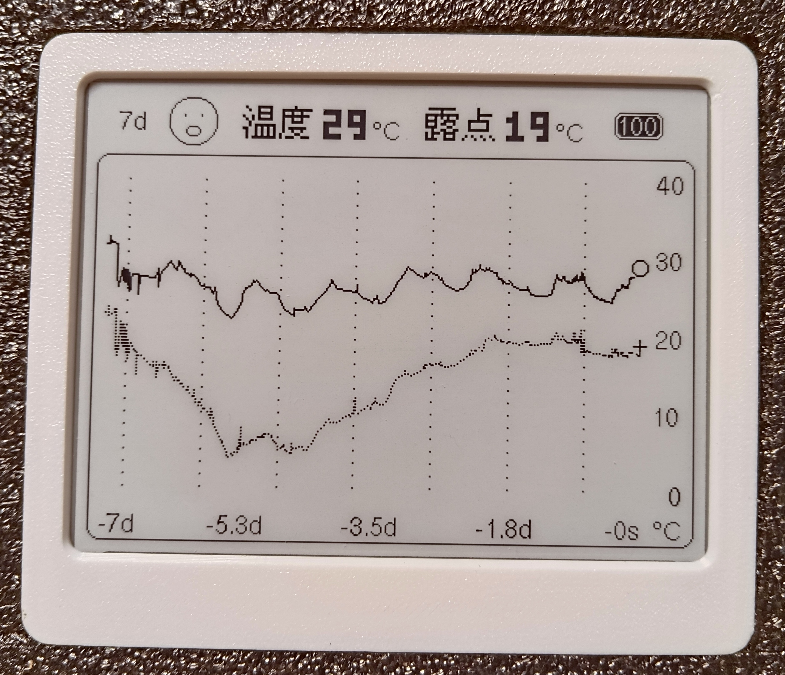
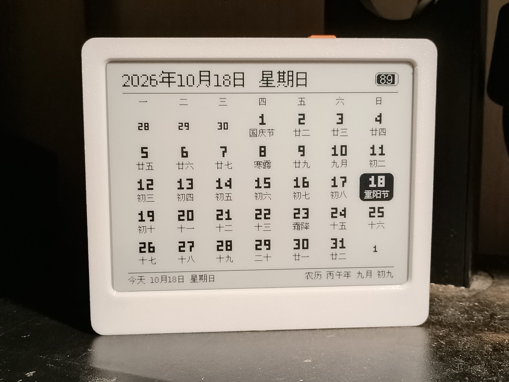
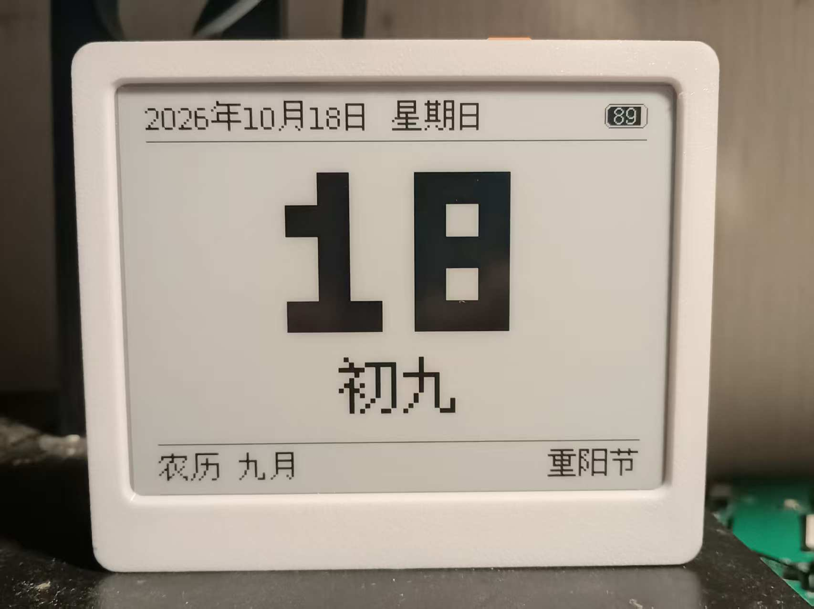

# 4.2 寸墨水屏温湿度计

一台可以自己动手复刻的低功耗温湿度计，使用 4.2 寸墨水屏显示温湿度历史曲线、日历和自定义图片。通过蓝牙连接网页上位机，就能查看环境数据、导出历史记录、调整设备设置和上传壁纸，无需安装专用 App。

本仓库存放网页上位机源码、蓝牙通信协议、预编译设备固件及展示资源。

## 实物展示

| 自定义壁纸 | 温湿度历史曲线 |
| :---: | :---: |
|  |  |

| 月历与农历 | 大字号日期 |
| :---: | :---: |
|  |  |

## 从这里开始

- **[打开在线上位机](https://ch58x-th-plot.cacherivulet.cn/)**：连接设备、查看历史、管理壁纸与设备设置。[备用访问地址](https://createskyblue.github.io/ch58x-th-plot/)。
- **[阅读蓝牙通信协议](docs/ble-protocol.md)**：GATT 通道、帧格式、命令载荷与状态码，方便开发第三方客户端。
- **[查看上位机入口源码](index.html)**：网页入口位于仓库根目录的 `index.html`。
- **[查看硬件开源工程](https://oshwhub.com/createskyblue/project_itmmifuv)**：原理图、PCB、物料及复刻说明。
- **[下载 3D 打印外壳](https://makerworld.com.cn/zh/models/3096359-4-2cun-mo-shui-ping-wen-du-ji-yi-nian-xu-hang-30ti#profileId-3645676)**：外壳模型与打印信息。

连接时，请使用支持 Web Bluetooth 的浏览器，长按设备按键开启蓝牙，再点击上位机中的“连接设备”。
